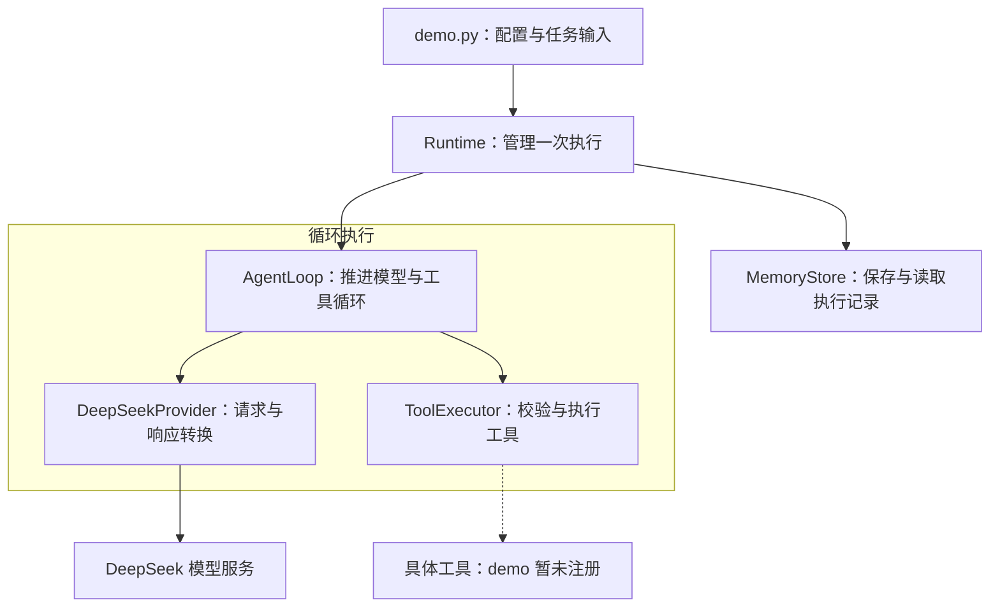

# My Harness System

一个用 Python 从零构建的个人 Agent Harness 学习项目。通过手写模型调用、工具执行、执行循环和状态管理，理解 Agent 从接收输入到返回结果的运行过程。

当前已实现单 Agent、单次执行、内存存储的最小闭环，并提供终端演示入口。后续希望用于个人研究助手；网络信息收集、板块轮动研究等业务能力尚未实现。

## 当前能力

- **模型接入**：通过 DeepSeek Provider 转换内部请求与响应，异步调用模型。
- **执行循环**：根据模型响应执行工具，并把结果加入下一轮上下文；支持步数上限和输出截断停止。
- **工具执行**：注册工具、检查本次允许使用的工具、使用 JSON Schema 校验参数，并关联调用与结果。
- **生命周期管理**：创建执行 ID，记录运行中、正常完成、停止或失败状态。
- **内存存储**：保存执行记录，读写使用深拷贝，避免调用者意外修改已保存数据。
- **运行入口**：`demo.py` 读取配置、接收一条任务并展示执行结果。

> 当前演示入口没有注册任何工具，只能进行模型问答，不能搜索网络或获取实时行情。每次启动执行一个独立任务，不会自动继承上次对话。

## 架构

下图中的实线表示调用或读写关系；虚线表示需要额外接入的具体工具。



各模块的职责：

| 模块 | 职责 |
| --- | --- |
| Runtime | 保存开始记录，调用 Loop，保存并返回结束记录；将 Loop 执行异常记录为失败 |
| Loop | 请求模型、追加消息、执行工具、判断继续或停止 |
| Provider | 屏蔽供应商请求与响应格式，不负责执行工具或持久化 |
| ToolExecutor | 检查工具是否允许使用、是否已注册及参数是否合法，然后执行 |
| Store | 保存和读取数据，不决定执行状态如何变化 |

一次执行可能包含多次模型调用。Loop 返回 `LoopResult`，Runtime 将其封装为 `RunRecord`：

| 执行状态 | 含义 |
| --- | --- |
| `running` | 执行已经开始，尚未结束 |
| `completed` | Loop 正常完成并给出最终回答 |
| `stopped` | 达到 `max_steps` 或发生 `output_truncated` |
| `failed` | Loop 执行期间发生异常 |

存储失败会向调用者抛出异常，不会被当作成功保存的失败记录。`completed` 表示执行流程正常结束，不代表回答内容已经得到业务验证。

## 快速开始

### 1. 准备环境

需要 Python 和 uv。项目元数据要求 Python 3.10 及以上，仓库的 `.python-version` 当前指定 Python 3.12。

在项目根目录执行：

```bash
uv sync
```

依赖由 `pyproject.toml` 声明，`uv.lock` 记录锁定版本。

### 2. 配置模型

在项目根目录创建 `.env`，与 `demo.py` 同级：

```dotenv
DEEPSEEK_API_KEY=替换为你的密钥
DEEPSEEK_BASE_URL=https://api.deepseek.com
DEEPSEEK_MODEL=替换为账号可用的模型名称
```

| 配置项 | 是否必需 | 说明 |
| --- | --- | --- |
| `DEEPSEEK_API_KEY` | 是 | 模型服务的访问密钥 |
| `DEEPSEEK_MODEL` | 是 | 实际调用的模型名称 |
| `DEEPSEEK_BASE_URL` | 否 | 默认使用 `https://api.deepseek.com` |

入口从自身所在目录加载 `.env`；已有系统环境变量优先，不会被文件中的同名变量覆盖。`.env` 已被 Git 忽略，不要将真实密钥提交到仓库。

### 3. 运行

```bash
uv run python demo.py
```

在提示后输入任务，例如：

```text
请输入任务：用三句话解释什么是 Agent 的工具调用。
```

程序将显示执行 ID、执行状态、停止原因，以及最终回答或错误信息。按 `Ctrl+C` 可以中断进程。

这个入口会向模型服务发送真实请求，使用你的账户额度。当前 `max_steps=5`，表示最多请求模型 5 次，不代表一次执行必须调用 5 次。

## 目录结构

```text
my_harness_system/
├── demo.py                       # 单次任务的终端入口
├── pyproject.toml                # 项目配置与依赖
├── uv.lock                       # 依赖锁定文件
├── Makefile                      # 测试命令
├── src/harness/
│   ├── provider/
│   │   ├── models.py             # 模型输入、响应、消息与工具调用类型
│   │   └── deepseek_provider.py  # DeepSeek 接入
│   ├── tool/
│   │   ├── models.py             # 工具定义
│   │   └── executor.py           # 工具注册、校验与执行
│   ├── runtime/
│   │   ├── models.py             # LoopResult 与 RunRecord
│   │   ├── loop.py               # Agent 循环
│   │   ├── runtime.py            # 执行生命周期管理
│   │   └── store.py              # 内存存储
│   └── gateway/                  # 预留包，尚未实现请求路由
└── tests/
    └── test_provider_models.py   # 当前已保存的数据模型测试
```

## 测试

```bash
uv run python -m unittest discover -s tests -v
```

也可以在完成环境安装后执行：

```bash
make test
```

当前仓库中的 3 个测试覆盖 `ToolCall` 的默认参数、必填调用 ID 和默认字典隔离。开发过程中还进行了使用模拟模型客户端的循环与生命周期检查，但这些集成检查尚未保存为回归测试，不能用现有测试数量代表完整覆盖。

## 当前限制

- Store 仅在进程内保存记录，进程退出后数据消失；没有数据库持久化或重启恢复。
- Runtime 只保存执行开始和结束记录。失败记录不包含完整的中途消息，原始请求也未单独持久化。
- 截断响应不进入后续消息历史，因此消息历史不等于完整调用审计记录。
- 没有持续交互的多轮会话、长期记忆、skills 加载或自动上下文检索。
- 工具机制已经存在，但演示入口未提供具体业务工具；工具执行也没有沙盒隔离。
- 没有网页界面、HTTP 服务或用户鉴权；Gateway 目前只有骨架。
- 尚未实现任务级超时、可记录的取消状态、任务队列或并发协调。

## 后续方向

以下是候选演进方向，不代表已实现或确定的开发顺序：

- 将已有的模拟集成检查保存为自动化测试。
- 接入简单工具，验证真实模型的工具调用流程。
- 扩展终端入口，明确会话历史的管理方式。
- 按实际需求增加数据库存储、执行进度记录和恢复能力。
- 在通用执行机制稳定后，接入信息收集和研究分析任务。

