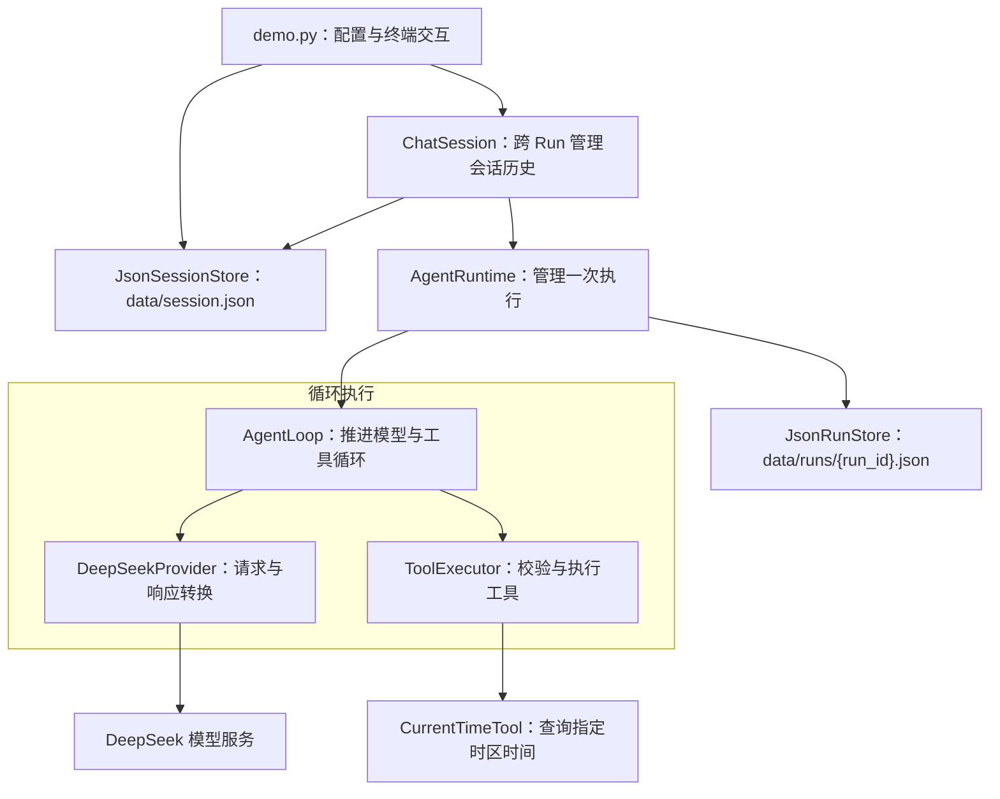

# My Harness System

一个用 Python 从零构建的个人 Agent Harness 学习项目。通过手写模型调用、工具执行、执行循环和状态管理，理解 Agent 从接收输入到返回结果的运行过程。

当前已实现 **单 Agent 工具调用、多轮对话、会话历史持久化和 Run 执行记录持久化**，并提供终端演示入口。业务方向是个人交易研究助手；网络信息收集、实时行情和研究分析等业务能力尚未实现。

进度核对日期：2026-11-24。最新实现提交为 `fb94653`（持久化 Run 执行记录并关联会话）。

## 当前能力

- **模型接入**：通过 `DeepSeekProvider` 转换内部请求与响应，异步调用模型；当前使用非流式响应。
- **执行循环**：根据模型响应执行工具，并把结果加入下一轮上下文；支持步数上限和输出截断停止。
- **工具执行**：注册工具、检查本次允许使用的工具、使用 JSON Schema 校验参数，并关联调用与结果。
- **时间工具**：演示入口已注册 `get_current_time`，可按指定时区返回带时区偏移的当前日期和时间。
- **多轮会话**：`ChatSession` 为每条有效任务输入创建独立 Run，复用此前成功保存的消息历史，包括工具调用和结果。
- **会话持久化**：`JsonSessionStore` 保存固定会话，重启后加载历史；支持 `/clear` 清空历史和 `/exit` 退出。
- **Run 持久化**：`JsonRunStore` 按 `run_id` 保存执行状态、所属 `session_id`、原始请求快照，以及结果或错误；支持按 ID 读取。
- **内存存储**：保留 `MemoryStore`，读写使用深拷贝，供测试和内存运行场景使用。

已完成的演进顺序：最小执行闭环 → 时间工具 → 多轮会话 → 会话历史持久化 → Run 执行记录持久化。详细调用事件、检查点和中断续跑尚未实现。

## 架构

演示入口使用以下执行链，箭头表示调用或读写关系：



各模块的职责：

| 模块 | 职责 |
| --- | --- |
| ChatSession | 组合已保存历史与当前输入，传入会话 ID；Run 正常完成后保存新历史，保存成功才更新内存 |
| AgentRuntime | 保存请求快照与开始记录，调用 Loop，保存并返回结束记录；将 Loop 执行异常记录为失败 |
| AgentLoop | 请求模型、追加消息、串行执行工具、判断继续或停止 |
| DeepSeekProvider | 屏蔽供应商请求与响应格式，不负责执行工具或持久化 |
| ToolExecutor | 检查工具是否允许使用、是否已注册及参数是否合法，然后执行 |
| JsonSessionStore | 保存和加载固定会话的 ID、时间戳与有序消息 |
| JsonRunStore / MemoryStore | 保存和读取 RunRecord，不决定执行状态如何变化 |

一个 Session 包含多次 Run，一次 Run 又可能包含多次模型调用。Loop 返回 `LoopResult`，Runtime 将其与请求快照、会话 ID、执行 ID 和时间戳一起封装为 `RunRecord`：

| 执行状态 | 含义 |
| --- | --- |
| `running` | 已保存开始记录，尚未记录最终状态 |
| `completed` | Loop 正常完成并给出最终回答 |
| `stopped` | 达到 `max_steps` 或发生 `output_truncated` |
| `failed` | Loop 执行期间发生异常 |

`completed` 表示执行流程正常结束，不代表回答内容已经得到业务验证。

## 持久化与会话行为

数据目录位于 `demo.py` 所在目录下，首次运行时按需创建：

| 路径 | 保存内容 | 更新方式 |
| --- | --- | --- |
| `data/session.json` | 会话 ID、创建/更新时间、已提交的完整消息历史 | 首次初始化、正常完成一轮并保存历史、执行 `/clear` 时更新 |
| `data/runs/{run_id}.json` | 当次 Run 的请求快照、状态、结果或错误 | 先写 `running`，结束后以最终记录覆盖同一个文件 |

- 启动时加载已有会话；会话文件不存在则创建空会话。文件损坏或不可读时明确报错并结束启动，不会静默覆盖为空会话。
- 仅 `completed` 且会话保存成功的轮次进入后续上下文；`failed`、`stopped` 或存储异常都保留此前历史。
- `/clear` 保存空历史，保留当前 `session_id` 和工具配置，也保留已有 Run 文件。清空保存失败时，内存历史保持原值。
- Run 保存失败会向外抛出异常。开始记录保存失败时不会调用模型；结束记录保存失败时可能留下 `running` 文件。
- 会话保存失败时，`SessionSaveError` 携带已完成的 Run，入口仍展示回答；已保存的 Run 保留，下一轮继续使用此前历史。
- 两类 JSON 存储均通过同目录临时文件替换目标文件。Run 和 Session 分别保存，没有跨文件事务，也不提供断电级持久性保证。

按 ID 查询由 `JsonRunStore.get(run_id)` 提供，返回 `RunRecord` 或在文件不存在时返回 `None`；当前没有终端查询命令。每个 Run 文件只保留最新记录，不是追加式事件日志。异常退出或取消后遗留的 `running` 只表示未记录到最终状态，程序不会自动判定失败或恢复执行。

`data/` 已被 Git 忽略。重启可加载已保存会话继续聊天，但不能从某次未完成 Run 的中途继续执行。

## 快速开始

### 1. 准备环境

使用 Python 3.12 和 uv；仓库的 `.python-version` 当前指定 3.12，本次测试也在 Python 3.12 下通过。

兼容性说明：`pyproject.toml` 仍声明 Python 3.10 及以上，但会话模型使用了 Python 3.11 才提供的 `typing.Self`，因此当前代码不兼容 Python 3.10；元数据与实现的版本要求尚待统一。

在项目根目录执行：

```bash
uv sync
```

依赖由 `pyproject.toml` 声明，`uv.lock` 记录锁定版本。

### 2. 配置模型

在项目根目录创建 `.env`，与 `demo.py` 同级：

```dotenv
DEEPSEEK_API_KEY=替换为你的密钥
DEEPSEEK_BASE_URL=https://api.deepseek.com
DEEPSEEK_MODEL=替换为账号可用的模型名称
```

| 配置项 | 是否必需 | 说明 |
| --- | --- | --- |
| `DEEPSEEK_API_KEY` | 是 | 模型服务的访问密钥 |
| `DEEPSEEK_MODEL` | 是 | 实际调用的模型名称 |
| `DEEPSEEK_BASE_URL` | 否 | 默认使用 `https://api.deepseek.com` |

入口从自身所在目录加载 `.env`；已有系统环境变量优先，不会被文件中的同名变量覆盖。`.env` 已被 Git 忽略，不要将真实密钥提交到仓库。

### 3. 运行

```bash
uv run python demo.py
```

程序先显示会话 ID 和已加载的历史消息数量，然后持续接收输入。例如：

```text
请输入任务：请用时间工具查询 Asia/Shanghai 当前时间。
请输入任务：上一条查询的是哪个时区？
请输入任务：/exit
```

每轮显示执行 ID、执行状态、停止原因，以及最终回答或错误信息。正常保存后，再次运行同一入口会加载已有历史继续对话；输入 `/clear` 清空会话历史，输入 `/exit` 或发送 EOF 退出。按 `Ctrl+C` 可以中断进程，但不会生成专门的取消状态。

这个入口会向模型服务发送真实请求，使用你的账户额度。当前每次 Run 的 `max_steps=5`，表示最多请求模型 5 次；工具是否被调用由模型响应决定。

## 目录结构

```text
my_harness_system/
├── demo.py                       # 多轮终端入口与依赖组装
├── pyproject.toml                # 项目配置与依赖
├── uv.lock                       # 依赖锁定文件
├── Makefile                      # 测试命令
├── src/harness/
│   ├── provider/
│   │   ├── models.py             # 模型输入、响应、消息与工具调用类型
│   │   └── deepseek_provider.py  # DeepSeek 接入
│   ├── tool/
│   │   ├── models.py             # 工具定义
│   │   ├── executor.py           # 工具注册、校验与执行
│   │   └── current_time.py       # 当前时间工具
│   ├── runtime/
│   │   ├── models.py             # LoopResult 与 RunRecord
│   │   ├── loop.py               # Agent 循环
│   │   ├── runtime.py            # 执行生命周期管理
│   │   └── store.py              # MemoryStore 与 JsonRunStore
│   ├── session/
│   │   ├── models.py             # SessionRecord
│   │   ├── chat_session.py       # 多轮上下文与历史提交
│   │   └── store.py              # JsonSessionStore
│   └── gateway/                  # 预留包，尚未实现请求路由
├── data/                         # 运行时生成，Git 忽略
│   ├── session.json              # 固定会话记录
│   └── runs/                     # 每次执行的 JSON 记录
└── tests/
    ├── harness_test_support.py   # 模拟模型客户端、确定性工具与组装辅助
    ├── test_provider_models.py   # 工具调用数据模型
    ├── test_runtime_integration.py # 执行链与请求快照
    ├── test_chat_session.py      # 多轮会话及历史提交边界
    ├── test_session_store.py     # 会话文件读写与故障处理
    └── test_run_persistence.py   # Run 文件存储与持久化集成
```

## 测试

```bash
uv run python -m unittest discover -s tests -v
```

也可以在完成环境安装后执行：

```bash
make test
```

截至 2026-11-24，执行 `make test`，**48 个测试全部通过**：

| 测试文件 | 数量 | 主要覆盖 |
| --- | --- | --- |
| `test_provider_models.py` | 3 | ToolCall 默认参数、必填 ID、默认字典隔离 |
| `test_runtime_integration.py` | 11 | 模型与工具执行链、停止与失败、请求快照、存储异常 |
| `test_chat_session.py` | 13 | 跨轮上下文、工具历史、会话隔离、重载、清空与保存失败 |
| `test_session_store.py` | 5 | 会话 JSON 读写、无效文件、读取错误、写入与替换失败 |
| `test_run_persistence.py` | 16 | Run 重载与覆盖、ID 校验、文件故障、会话关联、保存失败与取消 |

测试使用模拟模型客户端、确定性工具和临时目录，不读取实际会话文件、不调用真实模型 API。重载通过重新创建 Store、Session 等对象验证；取消通过 asyncio 任务取消验证。真实模型终端重启、进程崩溃和断电场景尚未完成端到端验收。

## 当前限制

- Run 只保存开始和结束记录，没有逐步事件、检查点或中断续跑；失败记录保留原始请求和错误，但不包含完整中途消息。
- 截断响应不进入结果消息历史，模型用量也未汇总到 Run，因此现有记录不是完整调用审计或成本追踪。
- 终端入口使用一个固定会话文件，没有多会话选择或并发写入协调；JSON 存储没有数据库、索引或迁移机制。
- 每轮发送完整已保存历史，尚无上下文裁剪、摘要、长期记忆、skills 加载或自动检索。
- 目前只提供时间工具，没有搜索、行情和领域研究工具；工具串行执行，没有沙盒隔离。
- 没有网页界面、HTTP 服务或用户鉴权；Gateway 目前只有骨架。
- 尚未实现任务级超时、可记录的取消状态、任务队列或并发协调。

## 后续方向

以下是候选演进方向，不代表已实现或确定的开发顺序：

- 完成真实模型下的终端续聊、重启加载、清空历史和时间工具验收。
- 结合现有实现学习回归测试，并统一 Python 支持版本声明。
- 根据具体任务确定执行事件、检查点、工具副作用和重试边界，再设计恢复能力。
- 按实际需求增加上下文管理、多会话管理或更适合的存储实现。
- 在通用执行机制稳定后，逐步接入个人交易研究所需的信息收集与分析工具。

